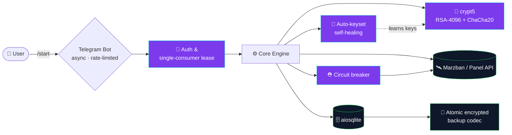

<!-- ╔══════════════════════════════════════════════════════════════════════╗ -->
<!-- ║   Mohammad Shirvani · 0xRadikal — GitHub Profile README (v3.0)         ║ -->
<!-- ║   Web3 Security Engineer · Node Operator · Telegram Systems Builder    ║ -->
<!-- ╚══════════════════════════════════════════════════════════════════════╝ -->

<a name="top"></a>

<!-- ░░░░░░░░░░░░░░░░░░░░  HERO  ░░░░░░░░░░░░░░░░░░░░ -->
<div align="center">


<a href="https://x.com/0xradikal">
  
</a>

<br/>

<!-- Social badges -->
<a href="https://github.com/0xRadikal"></a>
<a href="https://x.com/0xradikal"></a>
<a href="https://t.me/Raydikalx"></a>
<a href="https://youtube.com/@crypttopia"></a>
<br/>


</div>

<!-- ░░░░░░░░░░░░░░░░░░░░  DIVIDER  ░░░░░░░░░░░░░░░░░░░░ -->


<!-- ░░░░░░░░░░░░░░░░░░░░  ABOUT  ░░░░░░░░░░░░░░░░░░░░ -->
## <p align="center"> &nbsp;Whoami (?)</p>

```ts
const radikal: SecurityEngineer = {
  name:        "Mohammad Shirvani",
  alias:       ["0xRadikal", "Radikal.eth"],
  role:        "Web3 Security Engineer · Node Operator · Telegram Systems Builder",
  location:    "Iran 🇮🇷  ·  building for a borderless internet",
  focus:       ["Blockchain security", "Reverse engineering", "DePIN / Node ops",
                "Telegram automation at scale", "Anti-censorship infrastructure"],
  languages:   ["Python", "TypeScript", "JavaScript", "PHP", "SQL", "Solidity(read)"],
  currentlyBuilding: "Raydikalx — a self-healing Telegram VPN engine",
  philosophy:  "Systems aren't built for trends — they're built for endurance.",
  status:      "Open to Web3 security research & node-ops collaborations",
};
```

<div align="center">
<table>
<tr>
<td align="center" width="25%">
  <br/>
  <b>Security</b><br/><sub>Audits · Threat models · RE</sub>
</td>
<td align="center" width="25%">
  <br/>
  <b>Node Ops</b><br/><sub>17+ validators · 99.9% uptime</sub>
</td>
<td align="center" width="25%">
  <br/>
  <b>Telegram</b><br/><sub>8000+ users · solo-built</sub>
</td>
<td align="center" width="25%">
  <br/>
  <b>Web3</b><br/><sub>DeFi · DAO · TON · airdrops</sub>
</td>
</tr>
</table>
</div>


<!-- ░░░░░░░░░░░░░░░░░░░░  FLAGSHIP  ░░░░░░░░░░░░░░░░░░░░ -->
##  &nbsp;Flagship Systems

> Solo-designed, solo-built, solo-operated — from cryptography internals to community growth.

<table>
<tr>
<td width="50%" valign="top">

### 🛰️ Raydikalx — Telegram VPN Engine
[`@Raydikalx`](https://t.me/Raydikalx) · **5,000** pure-active members in **3 months**, solo-run · [`raydikalx-bot`](https://github.com/0xRadikal/raydikalx-bot) — **2,000 MAU**

A production-grade, self-healing subscription engine.

- 🔐 **Pure-Python Happ `crypt5` decryption** — RSA-4096 (PKCS#1 v1.5) + ChaCha20-Poly1305, reverse-engineered & ported 1:1, **34/34 vectors validated**
- 🧠 **Auto-keyset self-healing** — marker-aware detection + cryptographically-safe brute-force with 54 candidate keys & auto-learn
- 🗄️ **Atomic encrypted backup/restore** codec · single-consumer lease (race-free)
- 🧩 **Modular refactor** — 9,591-line monolith → clean DAG package (12 modules, zero circular imports)
- ⚙️ Marzban API · `curl_cffi` · circuit breaker · `aiosqlite`

`Python` `Cryptography` `AsyncIO` `Reverse-Engineering`

</td>
<td width="50%" valign="top">

### 🎁 TgPriceNFT — Gifts & Price Tracker
[`@TgPriceNft`](https://t.me/TgPriceNft) · [`Telegram-Gifts-Price`](https://github.com/0xRadikal/Telegram-Gifts-Price) — **1,000 MAU**

Real-time Telegram Gifts (NFT) & crypto price intelligence.

- 📈 **Server-side chart rendering** with GD + ImageMagick
- 🔀 Multi-source aggregation (giftcharts, hansha) · 24h / 7d / 30d windows
- 🗓️ **Jalali (Persian)** date engine · price alerts · cron auto-updates
- 💾 Automated DB backups · **99.9% uptime · <2s response**
- 🐘 PHP 8 · MySQL 8 · production-hardened

> One of my best web services — ran flawlessly until the Iran internet outage.

`PHP` `MySQL` `GD/ImageMagick` `Cron`

</td>
</tr>
<tr>
<td width="50%" valign="top">

### 🧠 CryptoPIA — DeFi Community
[`@crypttopiaa`](https://t.me/crypttopiaa) · YouTube [`@crypttopia`](https://youtube.com/@crypttopia)

Persian DeFi education & analytics hub — grown **1,000 → 6,000+** active members. Research, on-chain analysis, and airdrop strategy.

`Community` `DeFi` `Analytics` `Education`

</td>
<td width="50%" valign="top">

### 📝 Academic-Paper-Writer-Skill
[`Academic-Paper-Writer-Skill`](https://github.com/0xRadikal/Academic-Paper-Writer-Skill) · MIT

A **Claude skill** for Q1-level Persian academic writing — 3 modes (full paper / section / edit), APA7·IEEE·Vancouver citations, EQUATOR checklists, with extra depth in **security & networking**.

`AI-Skills` `Academic` `NLP` `Persian`

</td>
</tr>
</table>


<!-- ░░░░░░░░░░░░░░░░░░░░  OPEN SOURCE  ░░░░░░░░░░░░░░░░░░░░ -->
##  &nbsp;Open-Source Portfolio

<div align="center">

| Repository | What it does | Stack | ⭐ |
|:--|:--|:--|:-:|
| [**Free-v2ray-Configs**](https://github.com/0xRadikal/Free-v2ray-Configs) | Auto-updated free V2Ray configs every 30m — VLESS / VMess / Trojan / SS | `Python` |  |
| [**Telegram-Config-Extractor**](https://github.com/0xRadikal/Telegram-Config-Extractor) | Open-source V2Ray/Xray subscription decoder & config extractor | `Python` |  |
| [**sonic-dm**](https://github.com/0xRadikal/sonic-dm) | Automation tooling for the Sonic ecosystem | `JavaScript` |  |
| [**kaleido-bot**](https://github.com/0xRadikal/kaleido-bot) | Kaleido network automation bot | `JavaScript` |  |
| [**IRon-Gate**](https://github.com/0xRadikal/IRon-Gate) | Universal bridge — send everything to Rubika | `Python` |  |
| [**Rivalz-ai**](https://github.com/0xRadikal/Rivalz-ai) | Automated daily Rivalz fragment claiming | `JavaScript` |  |
| [**Foam-Sanat**](https://github.com/0xRadikal/Foam-Sanat) | Bilingual corporate website for Foam Sanat Industrial Group | `Next.js 15` |  |
| [**PoWeb-Point**](https://github.com/0xRadikal/PoWeb-Point) | Web-based presentation engine | `TypeScript` |  |
| [**Javid-Naman**](https://github.com/0xRadikal/Javid-Naman) | 🕯️ Open archive & chronicle of Iran's civil protests | `JavaScript` |  |

<sub>➕ Also: Sonic-daily-tx · RadikPool · pipe-net · zkradikal · Raydikalx-Core · mhr-cfw · Chem-lab · and private production bots.</sub>

</div>


<!-- ░░░░░░░░░░░░░░░░░░░░  TECH  ░░░░░░░░░░░░░░░░░░░░ -->
##  &nbsp;Tech Arsenal

<div align="center">

**Languages & Runtimes**<br/>


**Frameworks & Frontend**<br/>


**Infra · Data · Security**<br/>


**Web3 · Blockchain**<br/>


<br/>


</div>


<!-- ░░░░░░░░░░░░░░░░░░░░  STATS  ░░░░░░░░░░░░░░░░░░░░ -->
##  &nbsp;GitHub Analytics

<div align="center">


</div>


<!-- ░░░░░░░░░░░░░░░░░░░░  IMPACT  ░░░░░░░░░░░░░░░░░░░░ -->
##  &nbsp;Impact by the Numbers

<div align="center">

| 🚀 Metric | 📈 Result |
|:--|:--|
| Telegram members grown (solo) | **8,000+** across `@Raydikalx` + `@TgPriceNft` + `@crypttopiaa` |
| `@Raydikalx` growth | **5,000** pure-active members in **3 months** |
| Bots in production | **2,000 MAU** (`raydikalx-bot`) + **1,000 MAU** (`Telegram-Gifts-Price`) |
| Blockchain nodes operated | **17+** validators (EVM / SVM / TON) · **99.9%** uptime |
| Airdrop rewards secured | **$20,000+** |
| Optimism community NFTs | **500+** minted / distributed |
| Uptime / latency (services) | **99.9%** · **<2s** response |

</div>


<!-- ░░░░░░░░░░░░░░░░░░░░  EXPERIENCE  ░░░░░░░░░░░░░░░░░░░░ -->
<details>
<summary><b>💼 &nbsp;Professional Experience & Skill Matrix</b> &nbsp;(click to expand)</summary>

<br/>

**Exchange & Web3 roles** — Business Development / Growth / Community:
`Crypttopia` · `Bitunix` · `LBank` · `BingX` · `KCEX`

**Core competencies**

| Domain | Skills |
|:--|:--|
| 🔐 Security | Threat modeling · reverse engineering · cryptography (RSA / ChaCha20) · wallet & node security · forensics |
| 🖥️ Node Ops | Validator deployment · monitoring (Prometheus/Grafana) · uptime engineering · reward optimization |
| 🤖 Automation | Telegram bots at scale · async Python · circuit breakers · self-healing systems |
| 📣 Growth | **Telegram advertising (full mastery)** · organic community building · retention · analytics |
| 🌐 Web | Next.js / React / PHP full-stack · server-side rendering · charting engines |
| ⛓️ Web3 | DeFi · DAO · airdrop strategy · on-chain analysis · TON / EVM / SVM |

**Certifications & signals:** ICDL · Optimism community contributor (500+ NFTs) · MBTI **INTP**

</details>

<!-- ░░░░░░░░░░░░░░░░░░░░  ARCHITECTURE  ░░░░░░░░░░░░░░░░░░░░ -->
<details>
<summary><b>🧬 &nbsp;How I architect a resilient Telegram system</b> &nbsp;(click to expand)</summary>

<br/>



*Design principles: fail-closed security, idempotent state, race-free consumers, and self-healing over manual intervention.*

</details>


<!-- ░░░░░░░░░░░░░░░░░░░░  PERSIAN  ░░░░░░░░░░░░░░░░░░░░ -->
<div dir="rtl" align="right">

## 🇮🇷 فارسی

<div align="center">

</div>

<h3 align="center">محمد شیروانی (رادیکال) — مهندس امنیت وب۳ · اپراتور نود · سازندهٔ سیستم‌های تلگرامی</h3>

من محمد شیروانی هستم؛ پژوهشگر و توسعه‌دهندهٔ **خودآموخته** در حوزهٔ Web3، امنیت و اتوماسیون. سیستم‌هایی می‌سازم که در برابر خطا مقاوم، در برابر فشار شفاف و در برابر زمان پایدار بمانند.

**دستاوردهای کلیدی:**

- 🛰️ کانال **[@Raydikalx](https://t.me/Raydikalx)** — در ۳ ماه **۵٬۰۰۰ عضو خالص و فعال**، کاملاً به‌تنهایی مدیریت‌شده، با بازدید بالا.
- 🤖 ربات **[raydikalx-bot](https://github.com/0xRadikal/raydikalx-bot)** — **۲٬۰۰۰ کاربر فعال ماهانه**؛ موتور VPN خودترمیم با رمزگشایی خالصِ پایتونیِ `crypt5` (مهندسی معکوس).
- 🎁 کانال **[@TgPriceNft](https://t.me/TgPriceNft)** و ربات **[Telegram-Gifts-Price](https://github.com/0xRadikal/Telegram-Gifts-Price)** — **۱٬۰۰۰ کاربر فعال ماهانه**؛ یکی از بهترین سرویس‌های وبم که تا زمان قطعی اینترنت ایران بی‌نقص کار کرد.
- 🧠 کامیونیتی **CryptoPIA** — رشد از ۱٬۰۰۰ به **۶٬۰۰۰+** عضو فعال.
- 📝 اسکیل **[Academic-Paper-Writer-Skill](https://github.com/0xRadikal/Academic-Paper-Writer-Skill)** — نگارش مقالهٔ علمی فارسی در سطح جهانی (Q1).
- ⛓️ اپراتوری **۱۷+ نود** بلاک‌چین با آپتایم **۹۹٫۹٪** · ایردراپ **۲۰٬۰۰۰+ دلار** · تسلط کامل بر **تبلیغات تلگرام**.

> «سیستم‌های رادیکال برای مد ساخته نمی‌شوند؛ برای ماندگاری ساخته می‌شوند.»

</div>


<!-- ░░░░░░░░░░░░░░░░░░░░  CONNECT  ░░░░░░░░░░░░░░░░░░░░ -->
##  &nbsp;Let's Connect

<div align="center">

<a href="https://t.me/Raydikalx"></a>
<a href="https://t.me/TgPriceNft"></a>
<a href="https://x.com/0xradikal"></a>
<a href="https://youtube.com/@crypttopia"></a>

<br/><br/>

> *"Security, precision, and autonomy — every line of code should echo these."*


<a href="#top"></a>

</div>
