<a href="https://0xradikal.github.io/profile-card/"><picture><source media="(prefers-color-scheme: dark) and (max-width: 600px)" srcset="assets/profile/hero-dark-mobile.svg"><source media="(max-width: 600px)" srcset="assets/profile/hero-light-mobile.svg"><source media="(prefers-color-scheme: dark)" srcset="assets/profile/hero-dark.svg"></picture></a>

  <a href="#work"><b>Work</b></a> &nbsp;·&nbsp;
  <a href="https://t.me/ConfigExBot"><b>@ConfigExBot</b></a> &nbsp;·&nbsp;
  <a href="https://t.me/Raydikalx"><b>Telegram</b></a> &nbsp;·&nbsp;
  <a href="https://0xradikal.github.io/profile-card/"><b>Portfolio</b></a> &nbsp;·&nbsp;
  <a href="#fa"><b>فارسی</b></a>

I build tools that keep people connected — proxy pipelines that **prove** every link before publishing it,
Telegram bots that deliver them, and the web apps and research around them. Everything below is open source,
and every number on this page is read from a public source by a scheduled job, not typed by hand.

<a href="https://github.com/0xRadikal/Free-v2ray-Configs"><picture><source media="(prefers-color-scheme: dark) and (max-width: 600px)" srcset="assets/profile/stats-dark-mobile.svg"><source media="(max-width: 600px)" srcset="assets/profile/stats-light-mobile.svg"><source media="(prefers-color-scheme: dark)" srcset="assets/profile/stats-dark.svg"></picture></a>

## ◆ Flagship work

<a href="https://github.com/0xRadikal/Free-v2ray-Configs"><picture><source media="(prefers-color-scheme: dark) and (max-width: 600px)" srcset="assets/profile/project-v2ray-dark-mobile.svg"><source media="(max-width: 600px)" srcset="assets/profile/project-v2ray-light-mobile.svg"><source media="(prefers-color-scheme: dark)" srcset="assets/profile/project-v2ray-dark.svg"></picture></a>

  <a href="https://0xradikal.github.io/Free-v2ray-Configs/"><b>Live site</b></a> &nbsp;·&nbsp;
  <a href="https://github.com/0xRadikal/Free-v2ray-Configs"><b>Source</b></a> &nbsp;·&nbsp;
  <a href="https://raw.githubusercontent.com/0xRadikal/Free-v2ray-Configs/main/verified/configs.txt"><b>Verified subscription</b></a>

<a href="https://github.com/0xRadikal/Free-Telegram-Proxy"><picture><source media="(prefers-color-scheme: dark) and (max-width: 600px)" srcset="assets/profile/project-mtproto-dark-mobile.svg"><source media="(max-width: 600px)" srcset="assets/profile/project-mtproto-light-mobile.svg"><source media="(prefers-color-scheme: dark)" srcset="assets/profile/project-mtproto-dark.svg"></picture></a>

  <a href="https://0xradikal.github.io/Free-Telegram-Proxy/"><b>Live dashboard</b></a> &nbsp;·&nbsp;
  <a href="https://github.com/0xRadikal/Free-Telegram-Proxy"><b>Source</b></a> &nbsp;·&nbsp;
  <a href="https://raw.githubusercontent.com/0xRadikal/Free-Telegram-Proxy/main/top100.txt"><b>Top 100</b></a>

<a href="https://t.me/ConfigExBot"><picture><source media="(prefers-color-scheme: dark) and (max-width: 600px)" srcset="assets/profile/project-bot-dark-mobile.svg"><source media="(max-width: 600px)" srcset="assets/profile/project-bot-light-mobile.svg"><source media="(prefers-color-scheme: dark)" srcset="assets/profile/project-bot-dark.svg"></picture></a>

Reachability depends on your network and changes over time — the lists are re-tested every run for exactly that reason.

## ◆ More from the workbench

| Project | What it is |
| :--- | :--- |
| [**ovpn-checker**](https://github.com/0xRadikal/ovpn-checker) | Honest OpenVPN endpoint benchmarker — tests `.ovpn` files and picks the fastest, with explicit confidence levels. |
| [**pppoe-vlan-gpon-diagnostics**](https://github.com/0xRadikal/pppoe-vlan-gpon-diagnostics) | Read-only PowerShell toolkit and packet-level case study for PPPoE error 651 on GPON fiber. |
| [**pons-launchpad-forensics**](https://github.com/0xRadikal/pons-launchpad-forensics) | On-chain forensics of a bonding-curve launchpad — scripts, datasets, methodology. |
| [**Telegram-Config-Extractor**](https://github.com/0xRadikal/Telegram-Config-Extractor) | Open-source bot that decodes V2Ray / Xray subscriptions into ready-to-import files. |
| [**PoWeb-Point**](https://github.com/0xRadikal/PoWeb-Point) | A browser presentation engine — grid overview, topic menu, fullscreen mode, keyboard navigation. |
| [**Foam-Sanat**](https://github.com/0xRadikal/Foam-Sanat) | Bilingual industrial website — Next.js 14, TypeScript, Tailwind CSS. |

<b>Even more</b>

 

- [IRon-Gate](https://github.com/0xRadikal/IRon-Gate) — send files to Rubika.
- [Academic-Paper-Writer-Skill](https://github.com/0xRadikal/Academic-Paper-Writer-Skill) — a skill for structured academic writing.
- [Chem-lab](https://github.com/0xRadikal/Chem-lab) — a TypeScript monorepo.
- [Hash-Cats-Fun](https://github.com/0xRadikal/Hash-Cats-Fun) — tools around on-chain proof-of-work NFT mining.
- [profile-card](https://github.com/0xRadikal/profile-card) — the interactive portfolio.

## ◆ Contribution signal

<a href="https://github.com/0xRadikal"><picture><source media="(prefers-color-scheme: dark) and (max-width: 600px)" srcset="assets/profile/contributions-dark-mobile.svg"><source media="(max-width: 600px)" srcset="assets/profile/contributions-light-mobile.svg"><source media="(prefers-color-scheme: dark)" srcset="assets/profile/contributions-dark.svg"></picture></a>

## ◆ Find me

  <a href="https://t.me/Raydikalx"><b>Telegram · @Raydikalx</b></a> &nbsp;·&nbsp;
  <a href="https://t.me/v2adikal"><b>Group · @v2adikal</b></a> &nbsp;·&nbsp;
  <a href="https://t.me/crypttopiaa"><b>CryptoPIA · @crypttopiaa</b></a> &nbsp;·&nbsp;
  <a href="https://t.me/TgPriceNft"><b>@TgPriceNft</b></a>
   
  <a href="https://www.youtube.com/@crypttopia"><b>YouTube · @crypttopia</b></a> &nbsp;·&nbsp;
  <a href="https://x.com/ZKRadikal"><b>X · @ZKRadikal</b></a> &nbsp;·&nbsp;
  <a href="https://app.ens.domains/radikal.eth"><b>radikal.eth</b></a> &nbsp;·&nbsp;
  <a href="https://github.com/0xRadikal/.github#readme"><b>Support my work</b></a>

---

## ◆ فارسی

من **محمد شیروانی** هستم و با نام **رِیدیکال (Raydikalx)** ابزارهایی می‌سازم که آدم‌ها را وصل نگه می‌دارند:
لیست‌هایی که هر لینک را **قبل از انتشار واقعاً آزمایش** می‌کنند، ربات‌های تلگرامی که آن‌ها را به دستتان می‌رسانند،
و وب‌اپ‌ها و پژوهش‌های پیرامونشان. همهٔ این‌ها متن‌باز است و هر عددی که در این صفحه می‌بینید را یک کار زمان‌بندی‌شده
از منبع عمومی می‌خواند، نه این‌که دستی نوشته شده باشد.

- **[کانفیگ رایگان V2Ray](https://github.com/0xRadikal/Free-v2ray-Configs)** — جمع‌آوری کانفیگ‌های عمومی، حذف تکراری‌ها و آزمایش هر کدام با یک درخواست واقعی در سه دور. ([سایت](https://0xradikal.github.io/Free-v2ray-Configs/fa/))
- **[پروکسی رایگان تلگرام](https://github.com/0xRadikal/Free-Telegram-Proxy)** — هر پروکسی MTProto فقط وقتی منتشر می‌شود که سه بار یک درخواست واقعی را به دیتاسنتر تلگرام رسانده باشد. ([داشبورد](https://0xradikal.github.io/Free-Telegram-Proxy/))
- **[ربات ‎@ConfigExBot‎](https://t.me/ConfigExBot)** — کانفیگ رایگان مستقیم داخل تلگرام؛ بدون مرورگر و بدون لینک‌های طولانی.

کانال: [‎@Raydikalx‎](https://t.me/Raydikalx) · گروه: [‎@v2adikal‎](https://t.me/v2adikal) · کریپتوپیا: [‎@crypttopiaa‎](https://t.me/crypttopiaa) · [حمایت از پروژه‌ها](https://github.com/0xRadikal/.github#readme)

<a href="#top">↑ top</a>

<!-- Artwork: tools/profile/build.py renders assets/profile/*.svg from assets/profile/data.json;
     .github/workflows/profile.yml refreshes the data daily. -->
