<picture>
  <source media="(max-width: 600px)" srcset="assets/profile/hero-mobile.svg">
  
</picture>

  <a href="README.md"><b>English</b></a> &nbsp; / &nbsp;
  <a href="https://0xradikal.github.io/profile-card/"><b>پورتفولیو</b></a> &nbsp; / &nbsp;
  <a href="https://t.me/Raydikalx"><b>تلگرام</b></a>

# محمد شیروانی · 0xRadikal

با نام **Raydikalx** ابزارهای شبکه، سیستم‌های تلگرامی و اپلیکیشن‌های وب می‌سازم. پروژه‌هایم نرم‌افزار کاربردی را به پژوهش پروتکل‌ها پیوند می‌دهند: از جمع‌آوری و آزمایش پروکسی‌ها تا خودکارسازی کارها و تبدیل یافته‌های فنی به ابزارهای قابل‌استفاده.

**دسترسی آزاد به اینترنت · اتوماسیون تلگرام · پژوهش وب۳ · توسعهٔ وب**

## پروژه‌های شاخص

<a href="https://github.com/0xRadikal/Free-v2ray-Configs">
  <picture>
    <source media="(max-width: 600px)" srcset="assets/profile/project-v2ray-mobile.svg">
    
  </picture>
</a>

### [Free V2Ray Configs](https://github.com/0xRadikal/Free-v2ray-Configs)

پایپ‌لاین جمع‌آوری، حذف موارد تکراری و آزمایش کانفیگ‌های عمومی. ورود به فهرست verified به عبور از سه دور درخواست HTTP از داخل هر پروکسی نیاز دارد؛ خروجی‌ها شامل لینک سابسکریپشن و قالب‌های Clash و sing-box هستند.

`Python` · `GitHub Actions` · `V2Ray / Xray`

[سورس](https://github.com/0xRadikal/Free-v2ray-Configs) · [داشبورد](https://0xradikal.github.io/Free-v2ray-Configs/) · [پایپ‌لاین](https://github.com/0xRadikal/Free-v2ray-Configs/actions/workflows/aggregate.yml)

 

<a href="https://github.com/0xRadikal/Free-Telegram-Proxy">
  <picture>
    <source media="(max-width: 600px)" srcset="assets/profile/project-telegram-mobile.svg">
    
  </picture>
</a>

### [Free Telegram Proxy](https://github.com/0xRadikal/Free-Telegram-Proxy)

فهرست پروکسی‌های MTProto با سه دور آزمایش ارتباط با دیتاسنتر تلگرام، Top 100 با تنوع سرور، دسته‌بندی کشورها و خروجی JSON. داشبورد دوزبانه، مرور و بازکردن لینک‌های منتشرشده را ساده‌تر می‌کند.

`Python` · `MTProto` · `GitHub Pages`

[سورس](https://github.com/0xRadikal/Free-Telegram-Proxy) · [داشبورد](https://0xradikal.github.io/Free-Telegram-Proxy/) · [پایپ‌لاین](https://github.com/0xRadikal/Free-Telegram-Proxy/actions/workflows/update.yml)

نتایج هر دو پروژه از محیط اجرای آزمایش منتشر می‌شوند؛ دسترسی از شبکه‌های مختلف و در زمان‌های متفاوت می‌تواند تغییر کند.

### پروژه‌های بیشتر

| پروژه | موضوع |
| :--- | :--- |
| [**ovpn-checker**](https://github.com/0xRadikal/ovpn-checker) | سنجش سرورهای OpenVPN و انتخاب کانفیگ، همراه با تفکیک سطح اطمینان شواهد. |
| [**GPON diagnostics**](https://github.com/0xRadikal/pppoe-vlan-gpon-diagnostics) | ابزارهای PowerShell و مطالعهٔ موردی در سطح بسته‌های شبکه برای عیب‌یابی PPPoE، VLAN و ارتباط فیبر. |
| [**pons launchpad forensics**](https://github.com/0xRadikal/pons-launchpad-forensics) | پژوهش آن‌چین لانچ‌پد، همراه با اسکریپت‌های JSON-RPC، داده‌ها، روش بررسی و اصلاحات مستند. |
| [**PoWeb-Point**](https://github.com/0xRadikal/PoWeb-Point) | استودیوی ارائه در مرورگر با اسلایدساز، نماهای سه‌بعدی و پشتیبانی فارسی و انگلیسی؛ ساخته‌شده با React، TypeScript و Three.js. |
| [**Foam Sanat**](https://github.com/0xRadikal/Foam-Sanat) | وب‌سایت صنعتی دوزبانه با Next.js، TypeScript و Tailwind CSS. |
| [**Academic Paper Writer**](https://github.com/0xRadikal/Academic-Paper-Writer-Skill) | اسکیل Claude برای نگارش ساختاریافتهٔ مقالهٔ فارسی، ویرایش و بررسی ارجاع‌ها. |

<b>ادامهٔ پورتفولیوی عمومی</b>

#### شبکه و تلگرام

- [Telegram-Config-Extractor](https://github.com/0xRadikal/Telegram-Config-Extractor) — رمزگشایی سابسکریپشن و ساخت فایل کانفیگ از طریق تلگرام.
- [IRon-Gate](https://github.com/0xRadikal/IRon-Gate) — ابزار ارسال فایل و APK در تلگرام و روبیکا.

#### وب و پژوهش

- [Chem-lab](https://github.com/0xRadikal/Chem-lab) — مونوریپوی SaaS با TypeScript و محدودسازی دسترسی داده‌های API به سازمان مربوطه.
- [profile-card](https://github.com/0xRadikal/profile-card) — پورتفولیوی تعاملی با HTML، CSS و JavaScript.
- [Hash-Cats-Fun](https://github.com/0xRadikal/Hash-Cats-Fun) — ابزار و پژوهش ماینینگ NFT مبتنی بر اثبات کار آن‌چین.
- [Robin-hunt](https://github.com/0xRadikal/Robin-hunt) — آزمایش‌های عرضهٔ NFT و یادداشت‌های پژوهش فنی.
- [Sepid-o-Zarrin](https://github.com/0xRadikal/sepid-o-zarrin) — پروژهٔ جانبی پژوهش شیمی مواد غذایی با محاسبات پشتیبان.

#### آزمایش‌ها و یکپارچه‌سازی‌های قدیمی‌تر

[Sonic-daily-tx](https://github.com/0xRadikal/Sonic-daily-tx) · [sonic-dm](https://github.com/0xRadikal/sonic-dm) · [Sonic-SVM-Copy](https://github.com/0xRadikal/Sonic-SVM-Copy) · [Rivalz-ai](https://github.com/0xRadikal/Rivalz-ai) · [kaleido-bot](https://github.com/0xRadikal/kaleido-bot) · [RadikPool](https://github.com/0xRadikal/RadikPool) · [pipe-net](https://github.com/0xRadikal/pipe-net)

[مشاهدهٔ همهٔ ریپوهای عمومی ←](https://github.com/0xRadikal?tab=repositories&type=public)

## محصولات و پروژه‌های خصوصی

| پروژه | کاربرد | دسترسی |
| :--- | :--- | :--- |
| **Raydikalx / ConfigEx** | ابزارهای تلگرامی کانفیگ و سابسکریپشن. | [ربات](https://t.me/configexBot) · [کانال](https://t.me/Raydikalx) |
| **TgPriceNFT** | قیمت گیفت‌های تلگرام، نمودار بازار و ابزارهای قیمت. | [ربات](https://t.me/TgPriceNftBot) · [کانال](https://t.me/TgPriceNft) |
| **Coinkins** | توسعهٔ اپلیکیشن وب۳. | [وب‌سایت](https://app.coinkins.xyz/) |
| **OpenSea-Hunter** | خودکارسازی مینت SeaDrop برای کیف‌پول‌های واجد شرایط allowlist. | سورس خصوصی |
| **فروشگاه تلگرامی** | ویترین فروش، مدیریت سفارش و فرایند تحویل. | سورس خصوصی |

## ابزارهایی که با آن‌ها کار می‌کنم

| حوزه | فناوری‌های استفاده‌شده در پروژه‌ها |
| :--- | :--- |
| شبکه و اتوماسیون | **Python**، asyncio، APIهای تلگرام، GitHub Actions |
| رابط وب | **TypeScript**، JavaScript، React، Next.js، Three.js، Tailwind CSS |
| بک‌اند و داده | **PHP**، SQL، SQLite، MySQL |
| عیب‌یابی و پژوهش | **PowerShell**، تحلیل بسته‌های شبکه، JSON-RPC، داده‌های آن‌چین |

## رویکرد من

- **خودِ اندازه‌گیری را هم بررسی می‌کنم.** صحت محیط آزمایش و تفاوت خطای ابزار با خطای پروژه اهمیت دارد.
- **نتیجه باید قابل‌بررسی باشد.** اسکریپت‌ها، شواهد، محدودیت‌ها و اصلاحات را کنار کار ثبت می‌کنم.
- **برای استفاده طراحی می‌کنم.** مسیر رسیدن از ریپو به کانفیگ، ربات، داشبورد یا نتیجهٔ قابل‌بازتولید باید روشن باشد.

## ارتباط

[**تلگرام Raydikalx**](https://t.me/Raydikalx) · [**پورتفولیوی شخصی**](https://0xradikal.github.io/profile-card/) · [**ایکس / @0xradikal**](https://x.com/0xradikal)

برای گزارش باگ یا پیشنهاد فنی، در ریپوی مربوطه Issue باز کنید و مراحل یا شواهد لازم برای بازتولید را بنویسید.

RAYDIKALX &nbsp; / &nbsp; Open networks. Useful tools. <a href="#top">بازگشت به بالا ↑</a>

